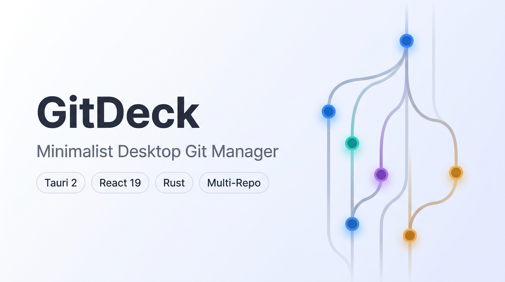
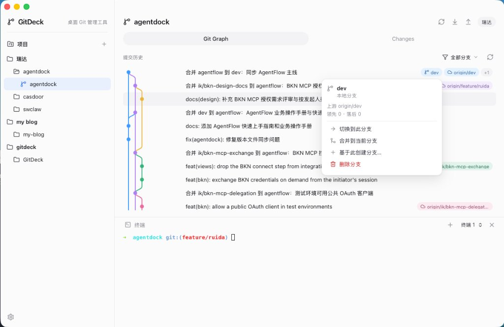
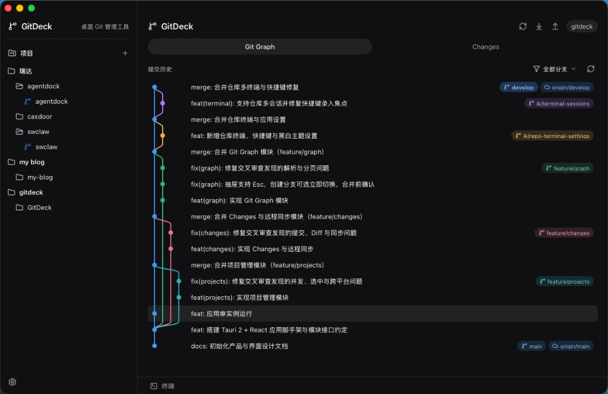
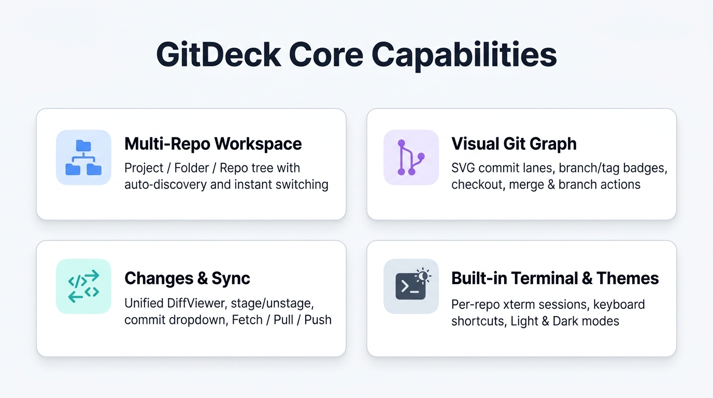
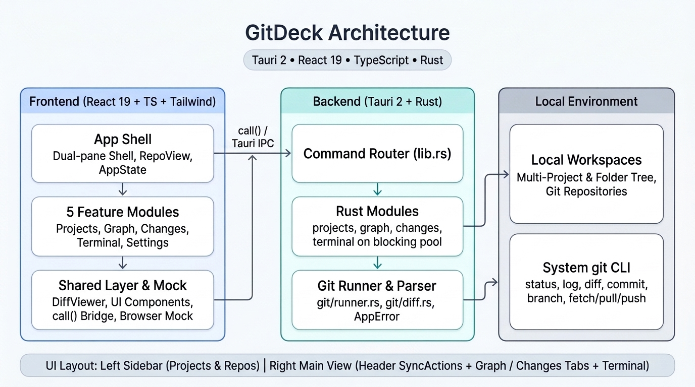

<div align="center">



# GitDeck

**一款参考 Cursor Git Graph 的极简桌面 Git 管理工具**  
聚焦操作简单、界面精致、低资源占用与多仓库统一管理 · 支持 macOS / Windows

[](https://tauri.app/)
[](https://react.dev/)
[](https://www.typescriptlang.org/)
[](https://tailwindcss.com/)
[](https://www.rust-lang.org/)

[界面预览](#-界面预览) · [核心能力](#-核心能力) · [系统架构](#-系统架构) · [快速开始](#-快速开始) · [相关文档](#-相关文档)

</div>

---

## ✨ 界面预览

GitDeck 采用极简双栏布局：**左侧**管理项目、文件夹与 Git 仓库树，**右侧**在 `Git Graph` 与 `Changes` 视图间切换，并支持浅色 / 深色主题与内置多会话仓库终端。

### 浅色主题 · Git Graph + 分支操作菜单 + 内置终端



### 深色主题 · 提交历史与多泳道图谱



---

## 🚀 核心能力



| 模块 | 核心特性 |
|---|---|
| **项目管理 (`projects`)** | 支持 **项目 / 文件夹 / Git 仓库** 三级树形管理，自动扫描识别文件夹内多个 Git 仓库，支持快速切换与本地持久化配置 |
| **Git Graph (`graph`)** | 基于 SVG 与虚拟列表渲染提交历史、多泳道分支与合并曲线；右侧对齐展示本地分支、远程分支（云朵图标）与 Tag 标签；支持分支筛选、创建、切换、合并与删除，以及 Commit 详情抽屉 |
| **Changes & 远程同步 (`changes`)** | 展示新增、修改、删除等工作区状态，共用 `DiffViewer` 查看差异，支持暂存、取消暂存、丢弃修改；提供 Cursor 风格提交下拉（提交 / 提交（修改）/ 提交和推送 / 提交和同步）及 Fetch / Pull / Push |
| **仓库终端与设置 (`terminal` / `settings`)** | 基于 `xterm` 的仓库内嵌终端，支持多终端会话切换；支持黑白主题切换与常用快捷键配置 |

---

## 🏗️ 系统架构

前端通过统一的 `call()` 桥接层调用后端命令：桌面运行时走 Tauri 2 IPC 调用 Rust 命令并经由 `git/runner.rs` 执行系统 `git` CLI，浏览器预览模式（`pnpm dev`）则自动分流到 `src/mock/` 进行本地联调。



---

## 🛠️ 快速开始

### 环境要求

- **Node.js** 22+ & **pnpm** 10+
- **Rust** 1.80+
- **Git** CLI

### 常用命令

```bash
# 安装依赖
pnpm install

# 启动 Tauri 桌面应用（连接真实 Rust 后端与本地 Git）
pnpm tauri dev

# 仅启动浏览器预览（http://localhost:1420，由 src/mock 模拟后端）
pnpm dev

# 全量检查：TypeScript 类型检查 + 前端 Vitest 单测 + Rust 单测 + Clippy
pnpm check

# 打包调试版桌面应用
pnpm tauri build --debug
```

<details>
<summary>查看更多单项检查命令</summary>

```bash
pnpm typecheck   # TypeScript 类型检查
pnpm test        # 前端单元测试 (Vitest)
pnpm test:rust   # Rust 后端单元测试 (cargo test)
pnpm lint:rust   # Rust Clippy 检查 (-D warnings)
```

</details>

---

## 🧰 技术栈

| 层级 | 选型 |
|---|---|
| **桌面框架** | Tauri 2 |
| **前端框架** | React 19 · TypeScript · Vite 8 |
| **样式与组件** | Tailwind CSS 4 · Radix UI · Lucide · Sonner |
| **虚拟列表与终端** | `@tanstack/react-virtual` · `@xterm/xterm` |
| **后端与 Git** | Rust · 系统 `git` CLI（`porcelain=v2` / `-z` 机器格式解析） |

---

## 📚 相关文档

- [产品设计文档](docs/product-design.md) — 产品定位、核心功能、技术方案与开发顺序
- [界面设计说明](docs/ui-design.md) — 界面原型转写与交互细节
- [仓库终端与应用设置设计](docs/design/0001-仓库终端与应用设置.md) — 内置终端与主题/快捷键设计文档
- [开发约定](AGENTS.md) — 目录结构、模块边界、前后端契约与测试规范
