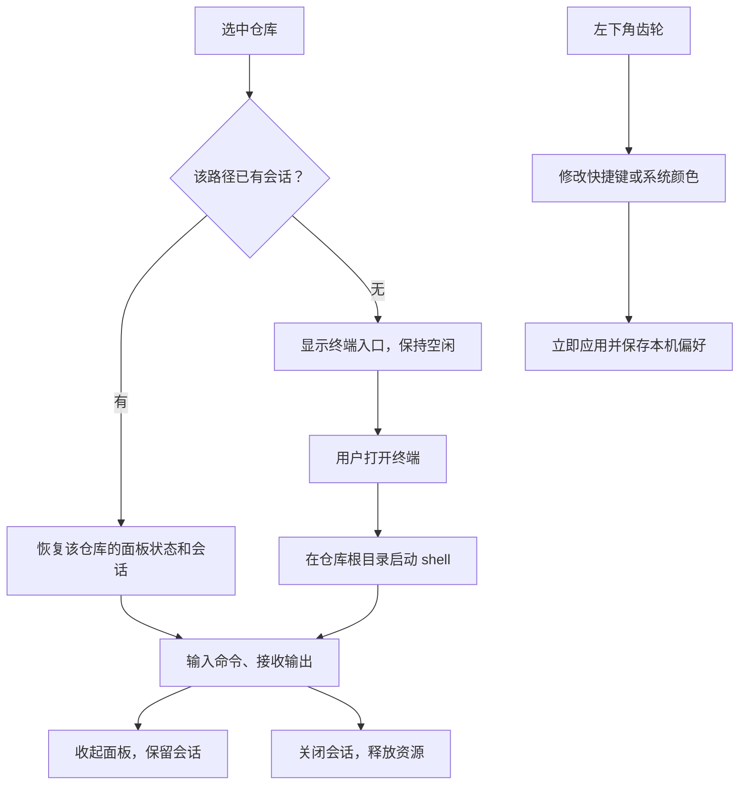

# RFC 0001 · 仓库终端与应用设置

- 日期：2026-11-23
- 状态：草稿

## 1. 需求理解

- 在右侧 Graph / Changes 下方加入可收起的交互式终端。打开时以当前选中仓库的根目录作为起始路径。同一项目里的两个仓库各有自己的终端上下文。
- 在左侧栏底部固定一个设置齿轮。即使没有选中仓库也能打开。设置仅含「快捷键」和「系统颜色」，对所有仓库生效。
- 白色沿用当前界面。黑色以本次提供的深色终端截图为视觉参考，覆盖整个应用。跟随系统仅决定采用哪套配色。
- 首版建议每个仓库按需打开一个会话，默认跟随系统。截图中的多个 zsh 会话只作视觉参考。极简和低占用贯穿设计，切换仓库本身不启动进程。

## 2. 接口改动

**仓库终端。** 从现有 `src/app/AppState.tsx` 读取 `selection.repoPath`。以仓库根目录绝对路径关联会话，因此同名仓库和同仓库的不同工作树都能按实际路径区分。用户在 shell 内执行 `cd` 后，切回该会话时保留其当前目录。没有选中仓库时隐藏终端入口。

拟在 `src/features/terminal/api.ts` 封装以下 Tauri 命令，在新模块 `src-tauri/src/terminal/` 实现。现有 Git runner 面向单次 Git 命令，交互式 shell 需要跨多次输入保留进程和伪终端（PTY）。

| 新增命令 | 输入 | 返回与行为 |
|---|---|---|
| terminal_open | repoPath、cols、rows、onEvent 通道 | 返回 sessionId。在仓库目录启动系统 shell。通过通道依次发送输出字节和退出通知。 |
| terminal_write | sessionId、data | 返回空，向对应 PTY 写入用户输入。 |
| terminal_resize | sessionId、cols、rows | 返回空，同步可见终端的字符宽高。 |
| terminal_close | sessionId | 返回空，结束对应会话并释放 PTY。应用退出时统一清理。 |

沿用现有 AppResult 错误契约。无效目录或尺寸返回 invalid，会话不存在返回 notFound，启动或读写失败沿用 io。收起只隐藏面板；关闭会话后，下次打开从仓库根目录重新开始。输出历史限制在有界缓冲内。终端焦点回到当前仓库视图时，复用 `src/lib/events.ts` 的 `emitRepoChanged(repoPath, "all")` 刷新 Graph / Changes。

**设置。** 在 `src/app/Shell.tsx` 的侧栏滚动区下方放置齿轮，点击打开紧凑弹窗。两项偏好在本地前端保存，沿用 AppState 的 localStorage 持久化方式，无需后端命令。

| 设置项 | 行为 |
|---|---|
| 快捷键 | 提供打开／收起当前仓库终端、切换 Graph、切换 Changes 三个动作。支持录入新组合、提示动作间重复绑定、恢复默认。应用内生效，编辑快捷键时暂停动作分发，终端保留 Ctrl+C 等常用控制键。 |
| 系统颜色 | 提供跟随系统、白色、黑色。默认跟随系统并响应系统外观变化。手动选择立即生效，已打开的终端同步换色并保留会话。 |

**黑色视觉参考。** 主窗口和终端画布采用截图中的近黑底色。分栏使用细深灰线，选中项用略亮的炭灰底，正文与光标用近白色。终端保留 ANSI 颜色，截图中青色目录、蓝色 Git 提示和红色分支名体现颜色关系，实际提示内容由用户的 shell 决定。Graph 泳道、文件状态和 Diff 增删沿用各自语义，并调整深色背景下的可读性。统一在 `src/styles.css` 定义主题 token。

## 3. 数据库改动

无。使用独立的本地偏好键保存主题模式与用户修改过的键位，缺省值使用内置配置。现有仓库选择和项目配置沿用原格式。终端会话仅在当前应用运行期间保留。

## 4. 流程图

## 5. 范围边界

首版包含仓库级单会话、底部面板、全局设置及黑白主题。多终端标签、分屏、会话跨重启恢复和自定义配色留到有实际需求时评估。浏览器预览使用现有 mock 路由演示交互，真实 shell 由桌面端提供。保留当前 Graph / Changes 导航，设置弹窗不占用常驻内容区域。

## 6. 验收标准

- [ ] 在一个项目中添加 A、B 两个仓库，分别首次打开终端，用 shell 查询当前路径，结果分别为 A、B 的根目录。切回 A 后，之前的输出、当前目录和运行中的命令均保留。
- [ ] 冷启动或仅浏览仓库时，终端渲染模块未加载，终端 shell 数量为零。收起再展开复用同一会话，关闭后释放对应进程。记录同条件下打包体积、空闲内存和空闲 CPU 的改动前后差值。
- [ ] 在 macOS 和 Windows 桌面端分别验证输入、输出、调整面板尺寸和中断命令。在终端暂存文件后点回 Changes，文件出现在暂存区。
- [ ] 项目列表滚动到底及空项目状态下，齿轮均可用。修改快捷键后能触发对应动作，重复绑定有提示，恢复默认和重启后的行为与设置一致。
- [ ] 白色保持现有外观。对照黑色参考检查终端背景、细分隔线、选中底色、文字和光标，并检查 Graph、Diff 与弹窗可读性。跟随系统时切换操作系统外观应立即生效；手动选色在重启后保留。

## 7. 影响面

共享层只需接入双栏布局、主题 token、桌面命令注册和浏览器 mock 路由。沿用项目现有按钮、提示、事件总线及错误结构。终端渲染按需加载；PTY 与渲染库选型待实施时在两个目标平台验证，依据功能、打包增量和运行占用决定。以真实 shell 往返和核心设置路径验证行为，控制依赖和测试规模。

## 8. 回滚方案

若发现会话串到其他仓库、退出后进程残留或黑色主题影响核心界面阅读，按受影响功能回退对应实现提交。回退终端时恢复原仓库视图布局；回退主题时恢复原白色 token。独立偏好键可由旧版忽略，项目配置与仓库数据无需迁移。
