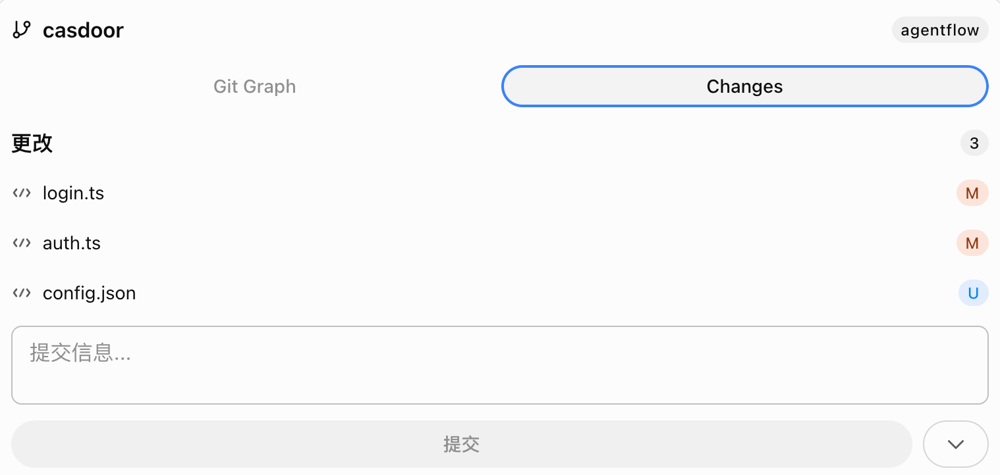
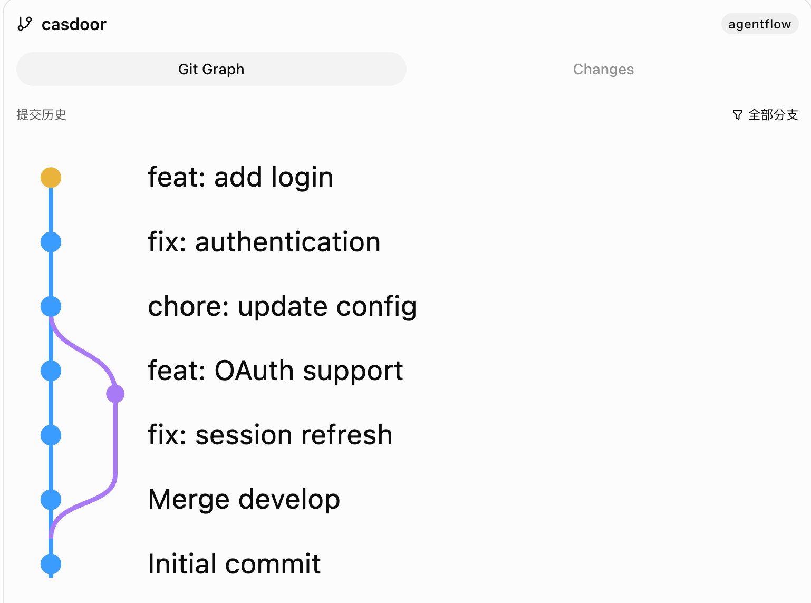
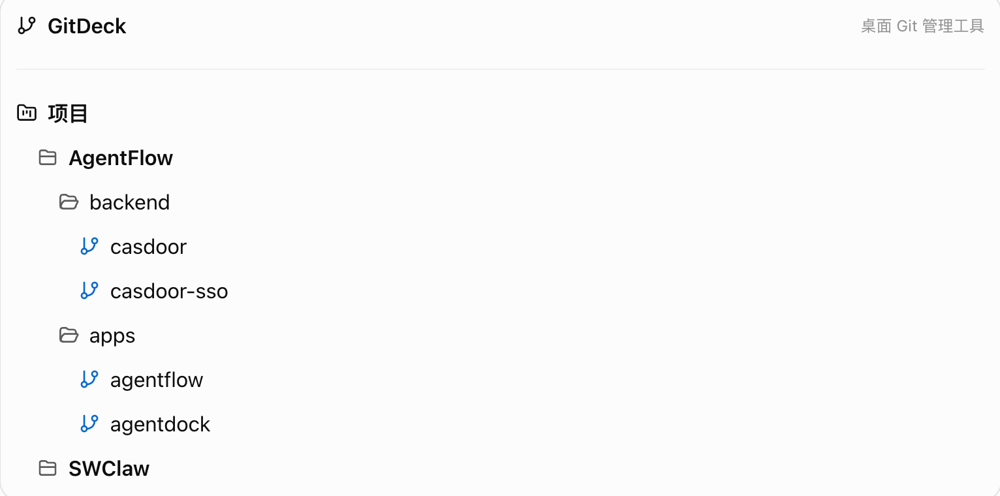

# GitDeck — 界面设计说明（原型转写）

> 本文档转写自三张界面原型图，并补充设计要点。原型为浅色主题；产品文档要求参考 Cursor 的深色风格，主题方案见文末「待确认事项」。

## 一、整体布局

产品采用极简双栏布局：

- **左侧**：项目 / 文件夹 / Git 仓库三级导航。
- **右侧**：当前仓库的 Git Graph 与 Changes 两个视图切换。
- 不设多余面板与工具栏。

三张原型分别对应：项目侧边栏、Git Graph 视图、Changes 视图。

---

## 二、项目侧边栏



### 布局与层级

```
┌──────────────────────────────────────────────┐
│ ⑂ GitDeck                  桌面 Git 管理工具  │
├──────────────────────────────────────────────┤
│ ▣ 项目                                       │
│   ▢ AgentFlow                                │
│     ▢ backend                                │
│       ⑂ casdoor                              │
│       ⑂ casdoor-sso                          │
│     ▢ apps                                   │
│       ⑂ agentflow                            │
│       ⑂ agentdock                            │
│   ▢ SWClaw                                   │
└──────────────────────────────────────────────┘
```

- **顶部**：Git 分支图标 + 产品名「GitDeck」；右侧为弱化的副标题「桌面 Git 管理工具」。
- **分区**：分隔线下为「项目」区，区头带树形图标。
- **三级结构**：
  - **项目**（加粗）：AgentFlow、SWClaw；
  - **文件夹**（常规字重 + 文件夹图标）：backend、apps；
  - **仓库**（Git 分支图标，品牌蓝）：casdoor、casdoor-sso、agentflow、agentdock。
- 每级按层级缩进，仓库图标用蓝色与普通文件夹区分。

### 视觉规格（目测近似，下同）

| 元素 | 规格 |
|---|---|
| 产品名 | 20px 半粗，近黑 |
| 副标题 | 13px，灰色 #8E8E93 |
| 项目名 | 15px 半粗 |
| 文件夹 / 仓库名 | 15px 常规 |
| 仓库图标 | 蓝色 #2F6FEB |
| 分隔线 | 1px #EAEAEA |

### 交互

- 点击项目 / 文件夹展开、收起。
- 点击仓库切换当前仓库，右侧切换到该仓库视图。
- 依据产品设计：一个项目可添加多个文件夹，一个文件夹可包含多个 Git 仓库；自动识别仓库；项目配置保存在本地 JSON。
- 原型未覆盖：选中态、右键菜单（添加文件夹 / 移除仓库等），实现时补充。

---

## 三、仓库视图通用头部

Git Graph 与 Changes 共享同一头部：

```
⑂ casdoor                              ( agentflow )
┌─────────────────────┐
│      Git Graph      │       Changes
└─────────────────────┘
```

- 左侧：Git 图标 + 仓库名（`casdoor`）。
- 右侧：浅灰胶囊标签显示所属项目名（`agentflow`）。
- 下方为两段式视图切换：`Git Graph` / `Changes`。
- 原型中选中态有「灰底胶囊」（图 2）与「蓝色描边胶囊」（图 3）两种画法，落地需统一为一种。

---

## 四、Git Graph 视图



### 顶部工具行

- 左：「提交历史」说明标签（灰色小字）。
- 右：筛选入口「全部分支」，支持按全部分支 / 本地分支 / 远程分支 / Tag 过滤。

### 提交列表

- 左侧为图谱栏，绘制泳道、节点与分叉 / 合并曲线；右侧为提交信息。
- 极简展示：默认只显示 commit message，不显示作者、时间、哈希（点击提交后再查看详情）。
- 原型示例（自新到旧）：

| 提交信息 | 节点 / 泳道 |
|---|---|
| feat: add login | 黄色节点（与 `ik/150-sso-login` 分支色一致） |
| fix: authentication | 蓝色主线（`agentflow`） |
| chore: update config | 蓝色主线；特性分支自此分叉 |
| feat: OAuth support | 蓝色主线 + 紫色特性分支节点（第二泳道） |
| fix: session refresh | 蓝色主线 |
| Merge develop | 蓝色主线；紫色分支线在此汇入 |
| Initial commit | 蓝色主线 |

### 分支引用标签（Refs）

每个 Commit 行**最右侧**对齐展示其指向的引用标签，随提交记录逐行对齐：

```
●  feat: add login        ⑂ ik/150-sso-login   ☁ origin/ik/150-sso-login
●  Merge develop                     ⑂ agentflow   ☁ origin/agentflow
```

- **本地分支**：分支图标 + 分支名。示例标签：黄色 `ik/150-sso-login`、蓝色 `agentflow`。
- **远程分支**：云朵图标 + 远程分支名（如 `origin/agentflow`），表示对应本地分支的远程跟踪引用。
- **Tag**：独立的引用标签（视觉样式待补充）。
- **颜色规则**：颜色**不固定代表本地或远程**，仅用于区分不同分支；本地 / 远程 / Tag 等引用类型一律以**图标**区分。
- 同一分支在图谱泳道中的颜色应与 Refs 标签颜色保持一致，便于人眼对应。
- 多个标签在行内横向排列、右对齐；分支名过长时截断，hover 展示完整名称（建议）。

### 交互

- 点击 Refs 标签：查看分支信息（含本地 / 远程跟踪关系）、切换分支等操作。
- 点击 Commit 行：查看该提交的文件变更与 Diff。
- 分支操作（依据产品设计）：筛选、创建、切换、合并、删除；原型未展示具体入口，建议用右键菜单或悬浮操作承载。
- Commit 详情建议以右侧抽屉 / 弹层展示，避免增加常驻面板（建议，待定）。

---

## 五、Changes 视图



### 更改列表

- 区头：「更改」加粗，右侧灰色胶囊显示变更数量（示例 `3`）。
- 行结构：代码文件图标（`</>`）+ 文件名 + 右侧状态徽标。
- 状态徽标（原型示例）：
  - `M`（已修改）：浅橙红底 + 橙色文字；
  - `U`（未跟踪 / 新增）：浅蓝底 + 蓝色文字；
  - `D`（已删除）：原型未出现，建议浅红底（待定）。
- 原型示例文件：`login.ts`（M）、`auth.ts`（M）、`config.json`（U）。
- 依据产品设计还需支持：查看 Diff、暂存 / 取消暂存、丢弃修改；原型未展示这些入口，建议通过行内悬浮操作或点击行展开 Diff 承载（待定）。

### 提交区

- **提交信息输入**：整宽圆角输入框（约 12px 圆角），placeholder「提交信息...」，支持多行。
- **提交按钮**：左侧为大宽度主按钮「提交」；无提交信息时置灰禁用（原型所示）。
- **提交下拉**：主按钮右侧独立的下拉按钮（向下箭头），展开提交方式：
  1. 提交
  2. 提交（修改）
  3. 提交和推送
  4. 提交和同步
- 依据产品设计还需支持 Fetch / Pull / Push；原型未展示入口位置（待定）。

---

## 六、通用视觉与设计原则

- **布局**：双栏、无第三栏、无多余面板。
- **主题**：原型为浅色主题（白底、近黑文字、灰色辅助信息）；产品文档要求参考 Cursor 深色主题，需确认最终方案（建议支持浅 / 深双主题）。
- **形状**：视图切换为全圆角胶囊；输入框与按钮为大圆角（约 12px）。
- **图标**：Lucide 线性图标（Git Branch、Folder、Cloud、Code 等）；图标承担引用类型识别职责（例如云朵 = 远程分支）。
- **强调色**：品牌蓝约 #2F6FEB。
- **状态色**：M 橙红、U 蓝；分支标签颜色按分支分配、跨视图保持一致。
- **字体**：系统无衬线（macOS 为 SF Pro / 苹方）。

---

## 七、待确认事项

1. **主题**：产品文档为深色主题，原型为浅色主题，需确认最终策略。
2. **Tab 选中态**：灰底与蓝描边两种画法需统一。
3. **Refs 细节**：Tag 的视觉样式、远程分支与本地分支标签的排列顺序、长分支名截断与 hover 提示。
4. **未覆盖交互**：分支操作菜单、Diff 面板、暂存 / 丢弃操作、Fetch / Pull / Push 入口位置需补充交互稿。
